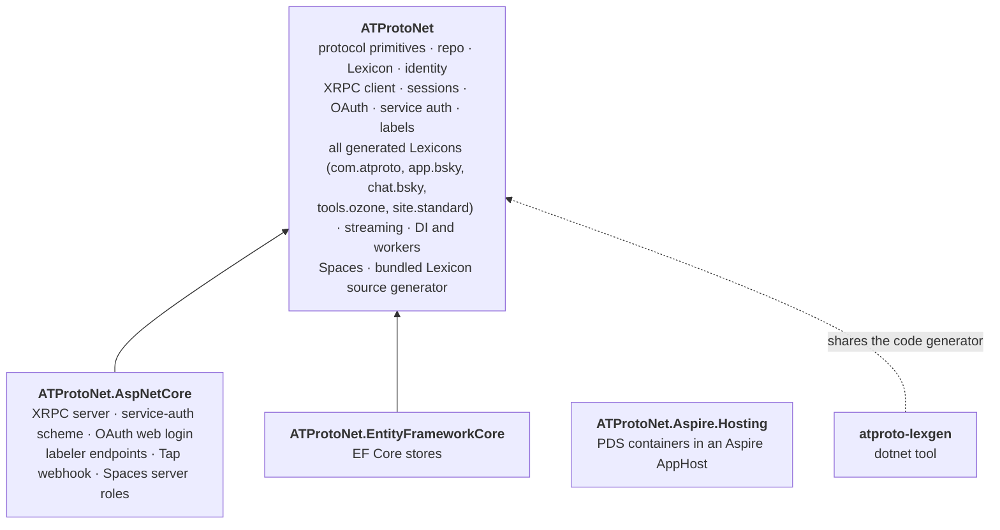
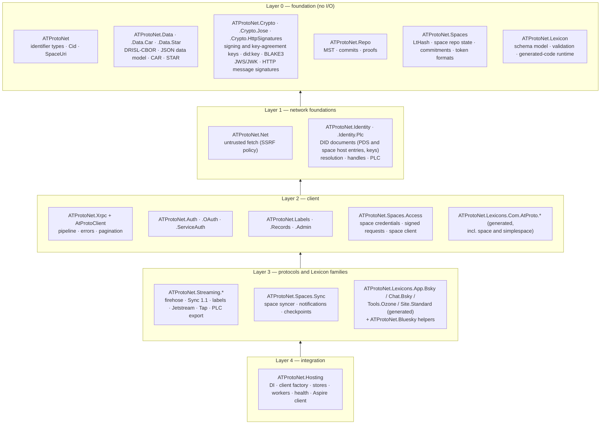
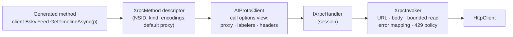
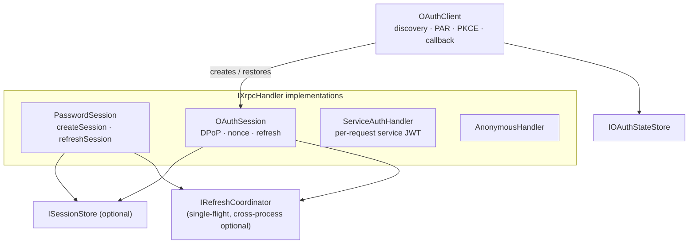
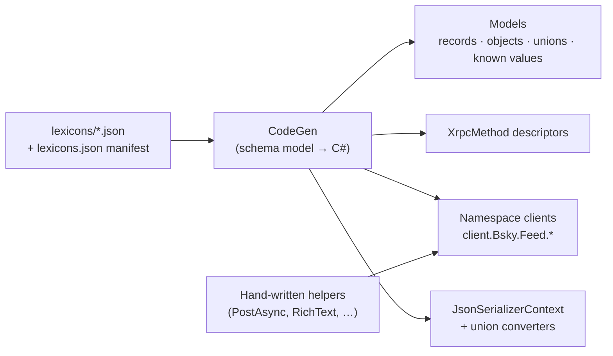
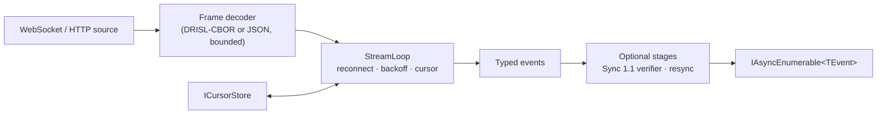

# 02 — Target architecture

This document describes the shape of the rewritten SDK: packages, the layers inside them, the core
abstractions and how they compose, and the cross-cutting conventions. The subsystem specs in
[`specs/`](specs/) define behaviour. This document defines structure.

## Packages

As few packages as possible, each with a clear scope
([D-03](06-decisions.md#d-03-package-map)). The base package contains almost everything. Extension
packages exist only where they would otherwise force a heavy framework dependency on everyone.



| Package | Install it when | Depends on (besides the BCL) |
|---|---|---|
| `ATProtoNet` | always: apps, bots, indexers, tools, worker services | small `Microsoft.Extensions.*` packages (Logging, Caching, DependencyInjection and Hosting abstractions, Options, Http, HealthChecks abstractions); `Microsoft.AspNetCore.DataProtection.Abstractions` (for the encrypted file session store). Never the ASP.NET Core shared framework. |
| `ATProtoNet.AspNetCore` | you serve XRPC endpoints, accept service auth, run the OAuth web login, a labeler or a Tap webhook | `ATProtoNet`, `Microsoft.AspNetCore.App` |
| `ATProtoNet.EntityFrameworkCore` | you persist sessions, OAuth state, replay entries, cursors or sync state in a database | `ATProtoNet`, `Microsoft.EntityFrameworkCore.Relational` |
| `ATProtoNet.Aspire.Hosting` | you run a PDS container (Bluesky or Tranquil) in an Aspire AppHost | Aspire hosting packages only; it starts containers and does not reference the SDK |
| `atproto-lexgen` | you lint, diff, publish or resolve Lexicons, or generate C# outside a build | (a `dotnet tool`) |

`ATProtoNet.AspNetCore` replaces 0.8's `ATProtoNet.Server`. It contains only what needs ASP.NET
Core. DI registration, the client factory, stores, stream workers, health checks and the Aspire
client integration move into `ATProtoNet` (namespace `ATProtoNet.Hosting`), so a worker service
or console app needs only the base package. There is no Blazor package: a Blazor Server app uses
`ATProtoNet.AspNetCore` and copies the per-circuit user client accessor and login form from
`samples/ServerIntegrationSample` ([D-09](06-decisions.md#d-09-blazor-components)).

The C# code generator (`ATProtoNet.Lexicon.CodeGen`, `netstandard2.0`) and the Roslyn source
generator built on it (`ATProtoNet.Lexicon.Generator`) are internal build projects, not packages.
The source generator ships as an analyzer inside the `ATProtoNet` package: referencing
`ATProtoNet` and adding Lexicon JSON files to a project is all a user needs to generate typed code
for their own Lexicons. The CLI compiles the same generator.

### Versioning

All packages share one version. The rewrite ships as **0.9.0**, with `0.9.0-preview.N` builds
first ([D-02](06-decisions.md#d-02-ship-as-09)). APIs marked `[Experimental]` (unspecced
upstream endpoints and the like; see [D-16](06-decisions.md#d-16-experimental-diagnostic-ids))
may change in any release. Everything else follows the compatibility rules of the 0.9 line.

## Layers inside `ATProtoNet`

The structure that 0.8 lacks comes from **namespace layers inside the base package**, not from
package boundaries. Consumers see one package. Contributors see clearly separated areas with
dependencies that only point down.



### Rules

1. **Layer 0 does no I/O.** No `HttpClient`, no sockets, no file system, no clock reads except
   through a passed-in `TimeProvider`. This keeps the protocol core reusable (a PDS or relay
   written in .NET can use it) and trivially testable.
2. **Dependencies point down.** A namespace may use its own layer's namespaces where the diagram
   allows and anything below, never above. Within layer 3, the Lexicon families depend on each
   other only along the Lexicon reference graph (`com.atproto` ← `app.bsky` ← `chat.bsky` ←
   `tools.ozone`, and `com.atproto` ← `site.standard`). Architecture tests on namespaces (NetArchTest or a Roslyn
   check) enforce all of this. The root namespace mixes layer-0 vocabulary types with
   `AtProtoClient` (layer 2), so the tests classify its types explicitly.
3. **No `InternalsVisibleTo` between production assemblies.** If `ATProtoNet.AspNetCore` needs
   something from `ATProtoNet`, it is public. Infrastructure that is public but not for app
   developers goes in an `*.Advanced` namespace with docs saying so.
4. **Both data protocols are built in, neither is bolted on.** Public repositories and Spaces
   each have their pieces in the layer where they belong ([D-08](06-decisions.md#d-08-spaces-is-a-first-class-part-of-the-protocol)).
   Shared mechanisms stay generic: the XRPC invoker signs nothing Spaces-specific (signed space
   requests are an `IXrpcHandler`), and hosting knows Spaces only through Spaces' own feature
   registration (0.8's transport signs Spaces requests, and its central in-memory-defaults
   warning knows Spaces stores). Moving surfaces that upstream has not specified carry
   `[Experimental]` instead of living in separate packages.
5. **The generator has no runtime dependency on the SDK.** `ATProtoNet.Lexicon.CodeGen` targets
   `netstandard2.0` and compiles the schema-model sources of `ATProtoNet.Lexicon` as linked files:
   one source of truth, compiled twice. See
   [specs/lexicon.md](specs/lexicon.md#generator-architecture).

### Why these layers

| Boundary | Reason |
|---|---|
| Layer 0 apart from everything | No I/O, highest reuse, slowest churn, easiest to test against interop vectors. |
| Repo and Spaces data structures apart from the data model | Public repositories (MST, signed commits) and space repositories (LtHash state, commitments) are the two storage structures; the data model they share stays small, and each structure's rules live in one place. |
| Lexicon apart from the client | The schema model is used by the generator, validation and tooling without an XRPC client. |
| Net and Identity below the client | OAuth discovery, Lexicon resolution and repo fetchers fetch from attacker-chosen hosts just as identity resolution does. One hardened layer (0.8's misnamed `IdentityFetch`) serves them all. |
| Lexicon families above the client core | The client core must not know about Bluesky. Families attach through extension properties ([D-13](06-decisions.md#d-13-lexicon-namespace-access-through-extension-properties)), the same mechanism users' own generated Lexicons use. |
| Spaces across the layers | Spaces is AT Protocol's second data protocol and shares identity, Lexicon, auth and XRPC with public repositories. Its pieces sit beside their public counterparts in each layer, so neither protocol is an add-on to the other ([D-08](06-decisions.md#d-08-spaces-is-a-first-class-part-of-the-protocol)). |
| Hosting on top | DI wiring composes everything below and nothing below depends on it, so every component works with `new` (AG-24). |

### Why not more packages

The first draft of this design split the base package into fifteen packages along these layers.
That was rejected ([D-03](06-decisions.md#d-03-package-map)): for consumers, many packages are
tedious and confusing (which ones do I need? which versions go together?), and 0.8's history of
merging and splitting packages shows the cost of getting it wrong. Namespace layers with
architecture tests give the same internal discipline. Apps that care about size use trimming,
which removes what they do not touch.

## Namespaces

| Namespace | Contents |
|---|---|
| `ATProtoNet` | identifier vocabulary (`Did`, `Handle`, `AtIdentifier`, `Nsid`, `AtUri`, `SpaceUri`, `RecordKey`, `Tid`, `AtDatetime`, `Cid`, `Language`), `AtProtoClient`, `AtProtoException` |
| `ATProtoNet.Data`, `.Data.Car`, `.Data.Star` | DRISL-CBOR reader/writer, JSON data model, `DataModelValue`, blobs, bytes, CID links, multiformats codecs, CAR reader/writer (public repositories), STAR reader/writer (space repositories) |
| `ATProtoNet.Crypto`, `.Crypto.Jose`, `.Crypto.HttpSignatures` | signing and verification keys, key-agreement keys (for the Spaces commitment), signatures, `did:key`, BLAKE3, `SignedObject`; JWS compact, JWK, thumbprints; RFC 9421 HTTP message signatures with RFC 8941 structured fields |
| `ATProtoNet.Repo` | public repositories: MST, commits, record proofs, snapshots, `IBlockStore` |
| `ATProtoNet.Spaces` | space repositories: LtHash state, commitments and MACs, space token formats and their verification |
| `ATProtoNet.Lexicon` (+ `.Validation`, `.Runtime`) | schema model, ref resolution, lint/diff rules, data validation, the types and attributes generated code uses |
| `ATProtoNet.Net` | untrusted-fetch layer: SSRF policy, bounded fetch, DNS TXT |
| `ATProtoNet.Identity`, `.Identity.Plc` | DID documents, DID/handle resolution and verification, caching, PLC client and operations |
| `ATProtoNet.Xrpc` | descriptors, `IXrpcHandler`, `XrpcInvoker`, call options, errors, pagination |
| `ATProtoNet.Auth`, `.Auth.OAuth`, `.Auth.ServiceAuth` | sessions, OAuth client, scopes, service-auth issuing and verification, store interfaces |
| `ATProtoNet.Labels` | label signing, verification, frame codec |
| `ATProtoNet.Records` | records API (`client.Records<T>()`) |
| `ATProtoNet.Admin` | PDS administration |
| `ATProtoNet.Streaming` (+ `.Firehose`, `.Jetstream`, `.Labels`, `.Tap`, `.Plc`, `.Advanced`) | event-stream runtime and the stream clients |
| `ATProtoNet.Bluesky` | hand-written Bluesky helpers: rich text, posting, profile updates, video upload, chat moderation stream |
| `ATProtoNet.Spaces.Access` | space credentials (consuming and issuing), signed space requests, the space-scoped client (`client.Space(uri)`) |
| `ATProtoNet.Spaces.Sync` | space syncer, write notifications, `listRepos` checkpoints |
| `ATProtoNet.Hosting` | DI builder, client factory, file session store, distributed-cache OAuth state store, stream workers, health checks, PDS admin registration, telemetry wiring, Aspire client integration. Registration extension methods live in `Microsoft.Extensions.DependencyInjection` (and `Microsoft.Extensions.Hosting` for Aspire), per framework convention. |
| `ATProtoNet.Lexicons.*` | generated code for every vendored Lexicon (`.Com.AtProto.*`, `.App.Bsky.*`, `.Chat.Bsky.*`, `.Tools.Ozone.*`, `.Site.Standard.*`, `.Com.AtProto.Space.*`, `.Com.AtProto.SimpleSpace.*`) |
| `ATProtoNet.AspNetCore` (+ `.Xrpc`, `.Authentication`, `.OAuth`, `.Labels`, `.Tap`, `.Spaces`) | the ASP.NET Core package |
| `ATProtoNet.EntityFrameworkCore` | the EF Core package |

The root `ATProtoNet` namespace holds only the vocabulary types, the client and the root
exception; everything else is in a sub-namespace.

## Core abstractions

### 1. Identifiers and data (layer 0)

The identifier types (`Did`, `Handle`, `AtIdentifier`, `Nsid`, `AtUri`, `RecordKey`, `Tid`,
`AtDatetime`, `Cid`, `Language`) validate on construction per the atproto syntax specs.
The data model has two encodings with one shape:

- **DRISL-CBOR** (`DrislReader`/`DrislWriter`, which read and write the bytes themselves, with explicit limits; phase 1 dropped `System.Formats.Cbor`, see [data-model](specs/data-model.md#phase-1-outcomes))
  for commits, MST nodes, firehose frames, CAR blocks and signatures. The reader is **strict by
  default** (canonical key order, no duplicates, minimal integers, definite lengths, valid UTF-8,
  only tag 42) because anything hashed or signed must be; a lenient mode is opt-in for display
  of foreign data. One `SignedObject` helper implements "encode without `sig`, sign, verify" for
  commits, labels, PLC operations and space commits (0.8 has five copies).
- **JSON** (System.Text.Json) for XRPC bodies and Lexicon objects. Data-model specials have
  fixed JSON forms: `$link` (CID link), `$bytes`, `blob`.

`DataModelValue` is the format-neutral tree used where no typed model exists (unknown
records, validation, CBOR↔JSON bridging). Typed models use generated System.Text.Json contracts.
See [specs/data-model.md](specs/data-model.md).

### 2. The XRPC pipeline (layer 2)



- **`XrpcMethod` descriptors** are generated per Lexicon method:
  `XrpcQuery<TParams, TOutput>`, `XrpcProcedure<TInput, TOutput>`, plus variants for no output,
  binary input and binary output. A descriptor carries the `Nsid`, the encodings, the JSON
  type info (source-generated), the declared error names and an optional default service
  proxy (for example `chat.bsky.*` → `did:web:api.bsky.chat#bsky_chat`). Whether a procedure
  has output comes from the Lexicon, so no hand-maintained "void procedure" list exists.
- **`AtProtoClient`** is a small, immutable object: an `IXrpcHandler` plus default call options
  (`atproto-proxy`, `atproto-accept-labelers`, extra headers). `client.With(options)` returns a
  view that shares the handler. `client.QueryAsync(descriptor, parameters, ct)` and
  `client.ProcedureAsync(descriptor, input, ct)` are the only call primitives. Generated
  namespace clients and hand-written helpers call them; so can user code.
- **`IXrpcHandler`** sends one prepared `XrpcRequest` and returns the response. This is where
  authentication lives ([D-06](06-decisions.md#d-06-a-session-is-the-authenticated-transport)):
  `AnonymousHandler`, `PasswordSession`, `OAuthSession`, `ServiceAuthHandler`, and
  `PdsAdminHandler` (HTTP Basic). Each decides the target service URL (the PDS from the
  session, or a fixed URL) and the credentials, and handles its own recovery (DPoP nonce
  retry, token refresh, single-flight).
- **`XrpcInvoker`** is the stateless core every handler delegates to: build
  `/xrpc/{nsid}` at the service root, encode parameters (repeated keys for arrays, invariant
  formatting), serialize the body once, send with HTTP/2-or-lower, read the response with
  bounds, map errors to the `XrpcException` hierarchy, apply the 429 policy, capture response
  metadata (`Atproto-Repo-Rev`, rate-limit headers) into an `XrpcResponseMetadata` the caller can
  observe. Anything else that speaks XRPC (Jetstream archive, repo fetchers, Spaces) reuses it.
  No second implementation exists.
- **No hidden retries.** The only retries are the DPoP nonce challenge (once), 429 with
  `Retry-After` up to a limit, and one resend after session recovery. No 5xx or network retries,
  and no resilience handler under the SDK, because those resend POSTs and spend DPoP proofs
  (lesson from 0.7, #136). Callers who want more retry policy wrap calls themselves.

### 3. Sessions and authentication (layer 2)



- A session object is the single owner of its tokens and its refresh. It is complete on its
  own: an `OAuthSession` carries the grant (authorization-server endpoints, DPoP key, client
  authentication) it needs to refresh and revoke itself, so nothing has to pass an
  `OAuthClient` alongside it (0.8 silently kept a stale session when callers forgot).
- Refresh is single-flight per account, keyed by credential generation: callers that saw the
  same tokens share one exchange, and an exchange that started always completes and persists,
  even if every caller gives up. Grant-specific behaviour (password vs OAuth refresh, revoke)
  is polymorphic, not a `switch` over session kinds.
- `ISessionStore` persists sessions *for* session objects; the client never touches it. The
  store offers **compare-and-swap** (`TryReplaceAsync(expected, next)` with a version), which is
  what makes multi-instance deployments correct without a distributed lock. The optional
  `IRefreshCoordinator` remains as an in-process optimisation.
- The OAuth client is a factory: `StartAuthorizationAsync` (resolve identity, discover the
  authorization server, PAR with PKCE and DPoP) and `CompleteAuthorizationAsync` (callback,
  issuer and `sub` binding checks, token exchange) produce `OAuthSession`s;
  `RestoreAsync(did)` rebuilds one from the store.
- Service auth is symmetric: `ServiceAuthHandler` mints tokens (client side), and
  `ServiceAuthVerifier` (in `ATProtoNet.Auth.ServiceAuth`, used by `ATProtoNet.AspNetCore`)
  verifies them with identity resolution and an `IReplayStore`.

See [specs/auth.md](specs/auth.md).

### 4. Generated Lexicon surface



- Every Lexicon definition becomes exactly one type in a namespace derived from its NSID
  ([D-05](06-decisions.md#d-05-lexicon-generated-type-naming)).
- A union is a C# 15 **`union`** type over its variant types, with a generated converter for the
  atproto wire format (`$type` read anywhere, written first in union position only). Open unions
  include the shared `LexiconUnknown` case that round-trips the raw object
  ([D-18](06-decisions.md#d-18-lexicon-unions-are-c-15-union-types)). Variant types need no base
  class or interface, so one type can belong to many unions, which is what 0.8's base-class model
  could not express.
- Namespace clients are lightweight structs over `AtProtoClient`, attached through C# 14
  extension properties, so the client core knows nothing about the Lexicon families and users'
  generated Lexicons attach the same way
  ([D-13](06-decisions.md#d-13-lexicon-namespace-access-through-extension-properties)).
- Records implement `IAtProtoRecord` (static `Collection`), so the records API
  (`client.Records<Post>()`) works for generated and user-defined records alike.

See [specs/lexicon.md](specs/lexicon.md).

### 5. Event streams (layer 3)



One `StreamLoop` owns connecting, reconnecting with jittered backoff, cursor resume and
persistence. Each protocol supplies a source (WebSocket URL builder) and a frame decoder.
Verification is a stage over typed firehose events, not a different consumer class. Each stream
yields a C# 15 `union` of its events and notices (`FirehoseItem`, `JetstreamItem`, …), so one
exhaustive `switch` handles everything it can produce
([D-23](06-decisions.md#d-23-stream-side-information-is-delivered-in-band)). Jetstream's zstd
compression uses .NET 11's built-in `ZstandardDecoder` with dictionaries.
See [specs/streaming.md](specs/streaming.md).

### 6. Hosting (`ATProtoNet.Hosting`, `ATProtoNet.AspNetCore`)

One builder: `services.AddAtProto(…)` returns `AtProtoBuilder`. On the builder, `Add*` adds a
feature (`AddClientFactory`, `AddStreamWorker<T>`, `AddXrpcEndpoints`, `AddOAuthLogin`,
`AddLabeler`, `AddTapWebhook`) and `Use*` selects the implementation of a seam with replace
semantics (`UseSessionStore<T>`, `UseReplayStore<T>`, `UseCursorStore<T>`). The one exception is
ASP.NET Core's own convention: the service-auth scheme registers on `AuthenticationBuilder`
(`AddAtProtoServiceAuth`). Endpoints map with `app.MapAtProto…()`. Every SDK `HttpClient` is a
named client from one registry (`AtProtoHttpClientNames`), configurable in one place.

The XRPC server reuses the generated descriptors, so a server endpoint and a client call share
one definition of the method, including subscriptions (WebSocket event streams), which 0.8
cannot serve. See [specs/server.md](specs/server.md) and
[specs/hosting.md](specs/hosting.md).

### 7. Two data protocols: public repositories and spaces

AT Protocol stores data in two ways that share identity, Lexicon, OAuth and XRPC. The SDK treats
both as first-class and gives each piece of one a counterpart in the same layer as the other:

| Concern | Public repositories | Spaces |
|---|---|---|
| Address | `AtUri` (`at://did/collection/rkey`) | `SpaceUri` (space and space-record forms; scheme per upstream GA, Q-15) |
| Storage structure | MST, signed commits (`ATProtoNet.Repo`) | LtHash state, KEM-based commitments and MACs (`ATProtoNet.Spaces`) |
| Export format | CAR (`ATProtoNet.Data.Car`) | STAR (`ATProtoNet.Data.Star`) |
| Who may read | everyone | members, through space credentials signed with HTTP message signatures (`ATProtoNet.Spaces.Access`) |
| Writing | `client.Records<T>()` | `client.Space(uri).Records<T>()` |
| Sync | firehose, Sync 1.1, Jetstream, Tap (`ATProtoNet.Streaming`) | space syncer, sequenced write notifications, checkpoints (`ATProtoNet.Spaces.Sync`) |
| Hosting | PDS (not implemented by the SDK) | space authority, repo host, `simplespace` roles (`ATProtoNet.AspNetCore`) |
| Identity | `#atproto_pds`, `#atproto` signing key | space host service entry, key-agreement key (`ATProtoNet.Identity`) |

See [specs/spaces.md](specs/spaces.md) for the Spaces protocol rules and their sources.

## Cross-cutting concerns

### Language and runtime

All runtime packages target `net11.0` and use C# 15
([D-25](06-decisions.md#d-25-target-net-11-and-c-15)). The features that shape the design:

| Feature | Used for |
|---|---|
| `union` types (C# 15) | Lexicon unions, stream items |
| `closed` hierarchies (C# 15) | SDK-owned closed sets: data-model values, sessions and session data, login hints, scopes, stream notices, verdicts ([AG-6a](03-api-guidelines.md#types)) |
| Extension members (C# 14) | attaching Lexicon namespaces to `AtProtoClient` |
| `required`, `init`, primary constructors, collection expressions | models and options throughout |
| `ZstandardDecoder`/`ZstandardDictionary` (.NET 11) | Jetstream live frames and archive blocks, with no third-party dependency |
| Zstandard in `SocketsHttpHandler` automatic decompression (.NET 11) | the SDK-owned HTTP handler |
| Runtime async (.NET 11) | no API impact; faster async paths, tracked by the benchmarks |

The code generator itself targets `netstandard2.0` (a Roslyn requirement) but emits C# 15 code
for `net11.0`. The SDK targets one framework at a time and moves to the next LTS (.NET 12,
November 2027) in a minor release.

### Configuration and DI

- Every component is constructible with `new` and works without DI (AG-24).
- The `ATProtoNet.Hosting` namespace adds `IServiceCollection` registration, options binding with
  `ValidateOnStart`, and `IHttpClientFactory` integration through one registry of named clients
  (`AtProtoHttpClientNames.Xrpc`, `.Identity`, `.OAuth`, `.Streaming`, `.Admin`, `.Spaces`). No
  resilience handler is ever added under SDK clients; the Aspire integration removes the
  service-defaults one from all of them, not only some (0.8 left admin and Spaces clients
  retrying POSTs).

### HTTP

- The SDK never mutates a supplied `HttpClient` (`BaseAddress`, default headers) and never reads
  them. All headers are per request. One `HttpClient` can serve many clients and sessions.
- When the SDK creates its own, it uses one shared `SocketsHttpHandler` configured for long-lived
  use (pooled connection lifetime, connect timeout, decompression), as 0.8 does.
- Identity fetches use a separate client whose handler enforces the SSRF policy
  ([specs/identity.md](specs/identity.md#network-policy)).

### Time

All time comes from `TimeProvider` (AG-28): token expiry, refresh scheduling, backoff, cache TTLs,
JWT `iat`/`exp`, TID generation.

### Serialization

Lexicon unions are serialized by generated converters rather than System.Text.Json's built-in
union support, which writes the active case without a discriminator.

One `AtProtoJson` entry point builds `JsonSerializerOptions` from source-generated contexts
(the SDK's, chained with those generated for the user's own Lexicons) and an optional user
`LexiconTypeRegistry` instance for
extension union variants. The options are created once per client configuration and frozen. No
process-global registry ([D-10](06-decisions.md#d-10-serialization-systemtextjson-with-source-generation-generated-union-converters)).

### Diagnostics

<a id="diagnostics"></a>

| Area | `ActivitySource`/`Meter` name | Logging event IDs |
|---|---|---|
| Layer 0 (`Data`, `Crypto`, `Repo`, `Lexicon`) | none (no I/O) | none |
| `ATProtoNet.Net`, `ATProtoNet.Identity` | `ATProtoNet.Identity` | 1000–1999 |
| `ATProtoNet.Xrpc`, `ATProtoNet.Auth`, `ATProtoNet.Admin` | `ATProtoNet.Xrpc`, `ATProtoNet.Auth` | 2000–2999 |
| `ATProtoNet.Streaming` | `ATProtoNet.Streaming` | 3000–3999 |
| `ATProtoNet.Spaces.*` (+ Spaces server roles) | `ATProtoNet.Spaces` | 4000–4999 |
| `ATProtoNet.Hosting`, `ATProtoNet.AspNetCore` | `ATProtoNet.AspNetCore` | 5000–5999 |
| `ATProtoNet.EntityFrameworkCore` | none | 6000–6999 |

Spans: one per XRPC call (`xrpc {nsid}`), per identity resolution, per stream connection.
Metrics: request duration and count by NSID and status, stream events and lag, cache hit rates,
refreshes.

### AOT and trimming

Every runtime package sets `IsAotCompatible` and `IsTrimmable`. Because `ATProtoNet` contains all
generated Lexicons, trimming is what keeps an app's footprint proportional to what it uses; the
generated code must therefore be fully trimmable (no reflection, source-generated JSON). A
NativeAOT smoke test app
(`tests/AotSmoke`) exercises login, a query, a record write and a firehose read, and must publish
with zero warnings.

## Source tree

```
/
├── lexicons/                     vendored Lexicon JSON (com/, app/, chat/, tools/, site/; Spaces from the proposal until GA)
├── lexicons.json                 manifest: NSID → source, CID, upstream commit
├── src/
│   ├── ATProtoNet/
│   │   ├── Data/ Crypto/ Repo/ Spaces/ Lexicon/    layer 0 (Spaces/ = space data structures)
│   │   ├── Net/ Identity/                          layer 1
│   │   ├── Xrpc/ Auth/ Labels/ Records/ Admin/     layer 2 (+ Spaces/Access/)
│   │   ├── Streaming/ Bluesky/                     layer 3 (+ Spaces/Sync/)
│   │   ├── Hosting/                                layer 4
│   │   └── Generated/                              checked-in generated Lexicon code, one folder per NSID authority
│   ├── ATProtoNet.AspNetCore/
│   ├── ATProtoNet.EntityFrameworkCore/
│   └── ATProtoNet.Aspire.Hosting/
├── tools/
│   ├── ATProtoNet.Lexicon.CodeGen/       internal; netstandard2.0
│   ├── ATProtoNet.Lexicon.Generator/     internal; packed into ATProtoNet as an analyzer
│   └── ATProtoNet.Lexicon.Cli/           atproto-lexgen
├── tests/
│   ├── ATProtoNet.Conformance/   spec vectors behind an adapter, API-independent
│   ├── ATProtoNet.TestKit/       shared fakes and store contract suites
│   ├── ATProtoNet.Tests/         base package, one folder per namespace area
│   ├── ATProtoNet.AspNetCore.Tests/
│   ├── ATProtoNet.EntityFrameworkCore.Tests/
│   ├── ATProtoNet.Lexicon.Tests/ generator and CLI
│   ├── ATProtoNet.IntegrationTests/
│   ├── ATProtoNet.Architecture.Tests/
│   ├── ATProtoNet.Benchmarks/
│   ├── AotSmoke/
│   └── ATProtoNet.DocSnippets(+.Generator)/
├── samples/
├── docs/                         user documentation (rewritten in phase 11)
└── design/                       this design
```

One test project per package keeps heavy test dependencies (TestHost, EF/SQLite, Roslyn)
out of the base package's tests, which was 0.8's monolithic-test-assembly problem. See
[04 — Testing](04-testing.md).
