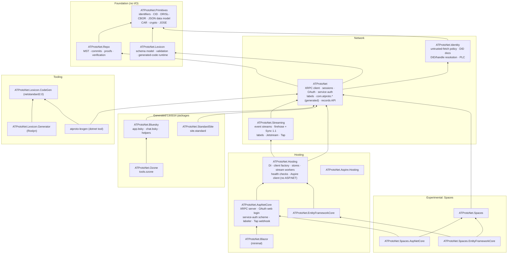
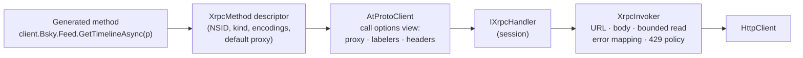
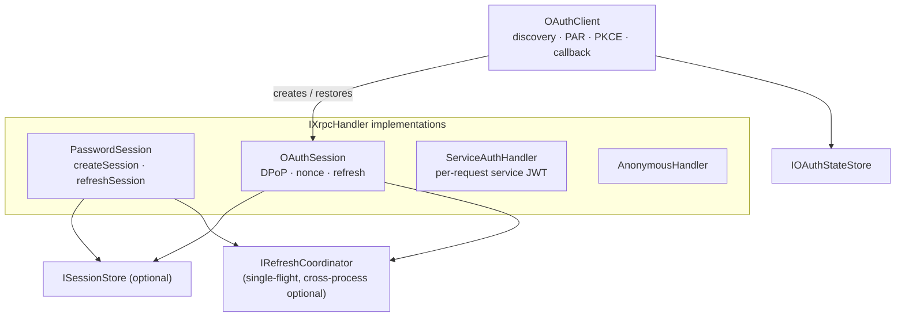
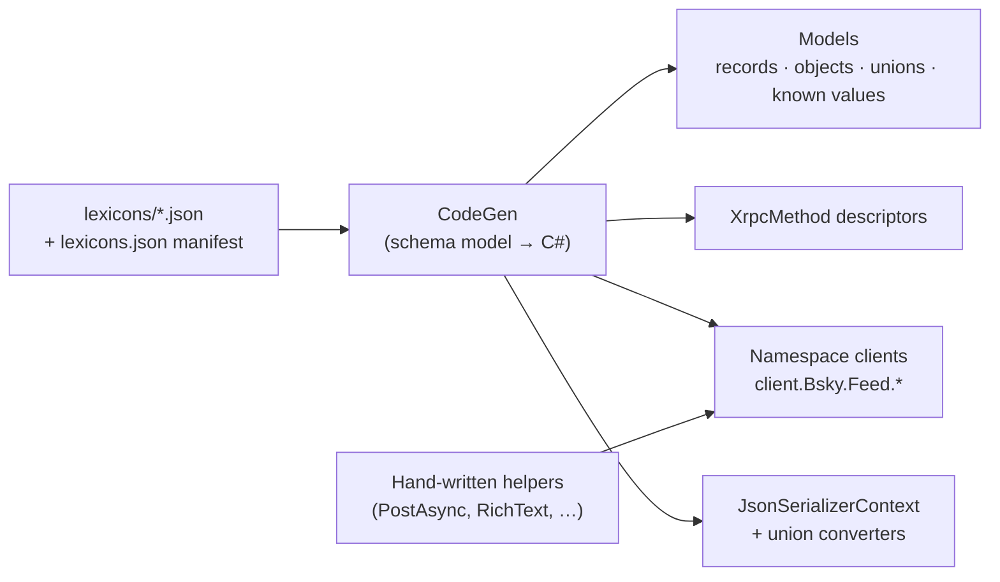
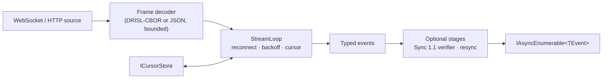

# 02 — Target architecture

This document describes the shape of the rewritten SDK: packages, dependency rules, the core
abstractions and how they compose, and the cross-cutting conventions. The subsystem specs in
[`specs/`](specs/) define behaviour. This document defines structure.

## Package map



Arrows point at dependencies. `ATProtoNet.Ozone` depends on `ATProtoNet.Bluesky` because
`tools.ozone` Lexicons reference `chat.bsky` and `app.bsky` definitions (the Lexicon reference
graph is a clean DAG: `com.atproto` ← `app.bsky` ← `chat.bsky` ← `tools.ozone`, and
`com.atproto` ← `site.standard`). `ATProtoNet.Aspire.Hosting` depends only on Aspire's hosting
packages; it starts containers and does not reference the SDK.

| Package | Depends on (besides the BCL) | Contents |
|---|---|---|
| `ATProtoNet.Primitives` | `System.Formats.Cbor` | identifier types, `Cid`, multiformats codecs, DRISL-CBOR reader/writer, JSON data model, `SignedObject`, CAR reader/writer, keys and signatures, `did:key`, JOSE (JWS compact, JWK, thumbprints) |
| `ATProtoNet.Repo` | Primitives | MST (one implementation), commits, record proofs, repository snapshots and verification, `IBlockStore` |
| `ATProtoNet.Lexicon` | Primitives | Lexicon schema object model, ref resolution, lint/diff rules, data validation against schemas, the runtime support generated code uses (union interfaces, `UnknownUnionVariant`, attributes) |
| `ATProtoNet.Identity` | Primitives, `Microsoft.Extensions.Logging.Abstractions`, `Microsoft.Extensions.Caching.Abstractions` | the untrusted-fetch layer (SSRF policy, bounded fetch, DNS TXT), DID documents, `did:plc`/`did:web` resolution, handle resolution and bidirectional verification, caching, PLC directory client and typed operations |
| `ATProtoNet` | Identity, Lexicon, Repo | `AtProtoClient`, XRPC pipeline, sessions (password, OAuth, service auth), OAuth client, scopes, service-auth verifier, labels (signing, verification, frame codec), records API, Lexicon resolution, `PdsAdminClient`, generated `com.atproto.*` |
| `ATProtoNet.Bluesky` | ATProtoNet | generated `app.bsky.*` and `chat.bsky.*`, rich text, post composition, profile updates, video upload |
| `ATProtoNet.Ozone` | ATProtoNet.Bluesky | generated `tools.ozone.*`, query filter records |
| `ATProtoNet.StandardSite` | ATProtoNet | generated `site.standard.*` |
| `ATProtoNet.Streaming` | ATProtoNet | event-stream core, firehose and Sync 1.1 verification and resync, label streams, Jetstream v1/v2, Jetstream archive, Tap client |
| `ATProtoNet.Hosting` | ATProtoNet, Streaming, `Microsoft.Extensions.{DependencyInjection,Options,Http,Hosting,Diagnostics.HealthChecks}.Abstractions`, `Microsoft.AspNetCore.DataProtection` | `services.AddAtProto()` builder, client factory, session-store selection, the file session store and the distributed-cache OAuth state store, refresh coordination, identity registration, stream workers, health checks, PDS admin registration, Aspire client integration, telemetry wiring. No ASP.NET Core shared framework. |
| `ATProtoNet.AspNetCore` | Hosting, `Microsoft.AspNetCore.App` | XRPC server endpoints (queries, procedures, subscriptions), service-auth authentication scheme, OAuth web login, `ClaimsPrincipal` adapters, labeler endpoints, Tap webhook |
| `ATProtoNet.EntityFrameworkCore` | Hosting, `Microsoft.EntityFrameworkCore.Relational` | EF Core stores: sessions, OAuth state, replay, cursors, repo sync state |
| `ATProtoNet.Blazor` | AspNetCore | per-circuit user client accessor, unstyled login form ([D-09](06-decisions.md#d-09-blazor-components)) |
| `ATProtoNet.Aspire.Hosting` | Aspire hosting packages | Bluesky PDS and Tranquil PDS container resources |
| `ATProtoNet.Spaces` | ATProtoNet | generated `com.atproto.space.*`/`simplespace.*`, space URIs, LtHash and BLAKE3, space commits, credentials and HTTP message signatures, syncer |
| `ATProtoNet.Spaces.AspNetCore` | Spaces, AspNetCore | space authority and repo host endpoints |
| `ATProtoNet.Spaces.EntityFrameworkCore` | Spaces, EntityFrameworkCore | EF Core space stores |
| `ATProtoNet.Lexicon.CodeGen` | (netstandard2.0, System.Text.Json) | schema model (linked sources) and the C# emitter |
| `ATProtoNet.Lexicon.Generator` | CodeGen (bundled) | Roslyn incremental generator over `AdditionalFiles` |
| `atproto-lexgen` | CodeGen, ATProtoNet, `System.CommandLine` | CLI: `generate`, `install`, `update`, `lint`, `diff`, `publish`, `resolve` |

### Rules

1. **Foundation packages do no I/O.** No `HttpClient`, no sockets, no file system, no clock
   reads except through a passed-in `TimeProvider`. They depend on the BCL plus
   `System.Formats.Cbor`. This makes them usable by any atproto implementation in .NET and
   keeps them trivially testable.
2. **Dependencies point down.** No package references a package at the same or a higher level
   except as drawn. Architecture tests (NetArchTest or a custom Roslyn check) enforce this.
3. **No `InternalsVisibleTo` between production assemblies.** If `ATProtoNet.AspNetCore`
   needs something from `ATProtoNet`, it is public. Infrastructure that is public but not for
   app developers goes in an `*.Advanced` namespace with docs saying so.
4. **Experimental packages are leaves.** Nothing stable depends on `ATProtoNet.Spaces`.
5. **The generator has no runtime dependency on the SDK.** `ATProtoNet.Lexicon.CodeGen` targets
   `netstandard2.0` and carries its own copy of the schema model sources (linked from
   `ATProtoNet.Lexicon`, so there is one source of truth compiled twice). See
   [specs/lexicon.md](specs/lexicon.md#generator-architecture).

### Why these boundaries

| Boundary | Reason |
|---|---|
| Primitives ↔ everything | No I/O, highest reuse, slowest churn. |
| Repo separate from Primitives | Only sync, verification and Spaces need the MST and commits; most apps do not. |
| Lexicon separate from the client | The schema model is needed by the generator, validation and tooling without an XRPC client. |
| Identity separate from the client | Resolution is needed by streaming, service-auth verification and OAuth, and is security-sensitive (SSRF). |
| One package per Lexicon family | Bluesky apps do not need Ozone. Custom-Lexicon apps do not need Bluesky. Upstream churn in one family stays in one package. |
| Streaming separate from the client | Indexers need it, typical apps do not. It carries the zstd seam and the Sync 1.1 machinery. |
| Spaces separate and experimental | Alpha protocol; see [D-08](06-decisions.md#d-08-spaces-is-quarantined-as-experimental). |
| Hosting separate from ASP.NET Core | Firehose workers, Jetstream indexers and console tools want DI, the client factory, stores, stream workers and health checks without taking `Microsoft.AspNetCore.App`. Today every one of them must reference `ATProtoNet.Server` and the whole shared framework. |
| One ASP.NET Core package | Its pieces (XRPC server, auth scheme, OAuth login, labeler, Tap webhook) share endpoint plumbing and add no dependencies beyond the shared framework. Splitting it further adds friction without saving weight. |
| Untrusted fetch in Identity | OAuth discovery, Lexicon resolution and repo fetchers fetch from attacker-chosen hosts just as identity resolution does. One hardened layer (today `IdentityFetch`, misnamed) serves them all; it lives in the lowest network package. |

## Namespaces

| Package | Namespaces |
|---|---|
| `ATProtoNet.Primitives` | `ATProtoNet` (identifier types, `Cid`, `AtDatetime`), `ATProtoNet.Data` (DRISL-CBOR reader/writer, JSON data model, blobs, bytes, CID links), `ATProtoNet.Data.Car`, `ATProtoNet.Crypto` |
| `ATProtoNet.Repo` | `ATProtoNet.Repo` |
| `ATProtoNet.Lexicon` | `ATProtoNet.Lexicon` (schema model), `ATProtoNet.Lexicon.Validation`, `ATProtoNet.Lexicon.Runtime` (base types and attributes the generated code uses) |
| `ATProtoNet.Identity` | `ATProtoNet.Identity`, `ATProtoNet.Identity.Plc`, `ATProtoNet.Net` (untrusted fetch) |
| `ATProtoNet` | `ATProtoNet` (`AtProtoClient`), `ATProtoNet.Xrpc`, `ATProtoNet.Auth`, `ATProtoNet.Auth.OAuth`, `ATProtoNet.Auth.ServiceAuth`, `ATProtoNet.Labels`, `ATProtoNet.Records`, `ATProtoNet.Admin`, `ATProtoNet.Lexicons.Com.AtProto.*` (generated) |
| `ATProtoNet.Bluesky` | `ATProtoNet.Bluesky` (helpers, rich text), `ATProtoNet.Lexicons.App.Bsky.*`, `ATProtoNet.Lexicons.Chat.Bsky.*` (generated) |
| `ATProtoNet.Streaming` | `ATProtoNet.Streaming`, `.Firehose`, `.Jetstream`, `.Labels`, `.Tap` |
| `ATProtoNet.Hosting` | `ATProtoNet.Hosting`; registration extension methods in `Microsoft.Extensions.DependencyInjection` and (Aspire) `Microsoft.Extensions.Hosting`, per framework convention |
| `ATProtoNet.AspNetCore` | `ATProtoNet.AspNetCore` and sub-namespaces per feature (`.Xrpc`, `.Authentication`, `.OAuth`, `.Labels`, `.Tap`) |

The root `ATProtoNet` namespace holds only the vocabulary types and the client; everything else
is in a sub-namespace.

## Core abstractions

### 1. Identifiers and data (Primitives)

The identifier types (`Did`, `Handle`, `AtIdentifier`, `Nsid`, `AtUri`, `RecordKey`, `Tid`,
`AtDatetime`, `Cid`, `Language`) validate on construction per the atproto syntax specs.
The data model has two encodings with one shape:

- **DRISL-CBOR** (`DrislReader`/`DrislWriter` over `System.Formats.Cbor`, with explicit limits)
  for commits, MST nodes, firehose frames, CAR blocks and signatures. The reader is **strict by
  default** (canonical key order, no duplicates, minimal integers, definite lengths, valid UTF-8,
  only tag 42) because anything hashed or signed must be; a lenient mode is opt-in for display
  of foreign data. One `SignedObject` helper implements "encode without `sig`, sign, verify" for
  commits, labels, PLC operations and space commits (0.8 has five copies).
- **JSON** (System.Text.Json) for XRPC bodies and Lexicon objects. Data-model specials have
  fixed JSON forms: `$link` (CID link), `$bytes`, `blob`.

`DataModelValue` is the format-neutral tree used where no typed model exists (unknown
records, validation, CBOR↔JSON bridging). Typed models use generated System.Text.Json contracts.
See [specs/data-model.md](specs/data-model.md).

### 2. The XRPC pipeline (ATProtoNet)



- **`XrpcMethod` descriptors** are generated per Lexicon method:
  `XrpcQuery<TParams, TOutput>`, `XrpcProcedure<TInput, TOutput>`, plus variants for no output,
  binary input and binary output. A descriptor carries the `Nsid`, the encodings, the JSON
  type info (source-generated), the declared error names and an optional default service
  proxy (for example `chat.bsky.*` → `did:web:api.bsky.chat#bsky_chat`). Whether a procedure
  has output comes from the Lexicon, so no hand-maintained "void procedure" list exists.
- **`AtProtoClient`** is a small, immutable object: an `IXrpcHandler` plus default call options
  (`atproto-proxy`, `atproto-accept-labelers`, extra headers). `client.With(options)` returns a
  view that shares the handler. `client.QueryAsync(descriptor, parameters, ct)` and
  `client.ProcedureAsync(descriptor, input, ct)` are the only call primitives. Generated
  namespace clients and hand-written helpers call them; so can user code.
- **`IXrpcHandler`** sends one prepared `XrpcRequest` and returns the response. This is where
  authentication lives ([D-06](06-decisions.md#d-06-a-session-is-the-authenticated-transport)):
  `AnonymousHandler`, `PasswordSession`, `OAuthSession`, `ServiceAuthHandler`, and
  `PdsAdminHandler` (HTTP Basic). Each decides the target service URL (the PDS from the
  session, or a fixed URL) and the credentials, and handles its own recovery (DPoP nonce
  retry, token refresh, single-flight).
- **`XrpcInvoker`** is the stateless core every handler delegates to: build
  `/xrpc/{nsid}` at the service root, encode parameters (repeated keys for arrays, invariant
  formatting), serialize the body once, send with HTTP/2-or-lower, read the response with
  bounds, map errors to the `XrpcException` hierarchy, apply the 429 policy, capture response
  metadata (`Atproto-Repo-Rev`, rate-limit headers) into an `XrpcResponseMetadata` the caller can
  observe. Anything else that speaks XRPC (Jetstream archive, repo fetchers, Spaces) reuses it.
  No second implementation exists.
- **No hidden retries.** The only retries are the DPoP nonce challenge (once), 429 with
  `Retry-After` up to a limit, and one resend after session recovery. No 5xx or network retries,
  and no resilience handler under the SDK, because those resend POSTs and spend DPoP proofs
  (lesson from 0.7, #136). Callers who want more retry policy wrap calls themselves.

### 3. Sessions and authentication (ATProtoNet)



- A session object is the single owner of its tokens and its refresh. It is complete on its
  own: an `OAuthSession` carries the grant (authorization-server endpoints, DPoP key, client
  authentication) it needs to refresh and revoke itself, so nothing has to pass an
  `OAuthClient` alongside it (0.8 silently kept a stale session when callers forgot).
- Refresh is single-flight per account, keyed by credential generation: callers that saw the
  same tokens share one exchange, and an exchange that started always completes and persists,
  even if every caller gives up. Grant-specific behaviour (password vs OAuth refresh, revoke)
  is polymorphic, not a `switch` over session kinds.
- `ISessionStore` persists sessions *for* session objects; the client never touches it. The
  store offers **compare-and-swap** (`TryReplaceAsync(expected, next)` with a version), which is
  what makes multi-instance deployments correct without a distributed lock. The optional
  `IRefreshCoordinator` remains as an in-process optimisation.
- The OAuth client is a factory: `StartAuthorizationAsync` (resolve identity, discover the
  authorization server, PAR with PKCE and DPoP) and `CompleteAuthorizationAsync` (callback,
  issuer and `sub` binding checks, token exchange) produce `OAuthSession`s;
  `RestoreAsync(did)` rebuilds one from the store.
- Service auth is symmetric: `ServiceAuthHandler` mints tokens (client side), and
  `ServiceAuthVerifier` (in `ATProtoNet`, used by `ATProtoNet.AspNetCore`) verifies them with
  identity resolution and an `IReplayStore`.

See [specs/auth.md](specs/auth.md).

### 4. Generated Lexicon surface



- Every Lexicon definition becomes exactly one type in a namespace derived from its NSID
  ([D-05](06-decisions.md#d-05-lexicon-generated-type-naming)).
- A union is a generated **interface**; each variant type implements every union it appears in,
  and open unions get a generated `Unknown…` variant that round-trips the raw object
  ([D-18](06-decisions.md#d-18-unions-are-interfaces)). Today's single-base-class model forced
  duplicate types and wrong subtypes.
- Namespace clients are lightweight structs over `AtProtoClient`, attached through C# 14
  extension properties, so packages compose without the core knowing about them
  ([D-13](06-decisions.md#d-13-lexicon-namespace-access-through-extension-properties)).
- Records implement `IAtProtoRecord` (static `Collection`), so the records API
  (`client.Records<Post>()`) works for generated and user-defined records alike.

See [specs/lexicon.md](specs/lexicon.md).

### 5. Event streams (ATProtoNet.Streaming)



One `StreamLoop` owns connecting, reconnecting with jittered backoff, cursor resume and
persistence. Each protocol supplies a source (WebSocket URL builder) and a frame decoder.
Verification is a stage over typed firehose events, not a different consumer class.
See [specs/streaming.md](specs/streaming.md).

### 6. Hosting (ATProtoNet.Hosting, ATProtoNet.AspNetCore)

One builder: `services.AddAtProto(…)` returns `AtProtoBuilder`. On the builder, `Add*` adds a
feature (`AddClientFactory`, `AddStreamWorker<T>`, `AddXrpcEndpoints`, `AddOAuthLogin`,
`AddLabeler`, `AddTapWebhook`) and `Use*` selects the implementation of a seam with replace
semantics (`UseSessionStore<T>`, `UseReplayStore<T>`, `UseCursorStore<T>`). The one exception is
ASP.NET Core's own convention: the service-auth scheme registers on `AuthenticationBuilder`
(`AddAtProtoServiceAuth`). Endpoints map with `app.MapAtProto…()`. Every SDK `HttpClient` is a
named client from one registry (`AtProtoHttpClientNames`), configurable in one place.

The XRPC server reuses the generated descriptors, so a server endpoint and a client call share
one definition of the method, including subscriptions (WebSocket event streams), which 0.8
cannot serve. See [specs/server.md](specs/server.md) and
[specs/hosting.md](specs/hosting.md).

## Cross-cutting concerns

### Configuration and DI

- Every component is constructible with `new` and works without DI (AG-24).
- `ATProtoNet.Hosting` adds `IServiceCollection` registration, options binding with
  `ValidateOnStart`, and `IHttpClientFactory` integration through one registry of named clients
  (`AtProtoHttpClientNames.Xrpc`, `.Identity`, `.OAuth`, `.Streaming`, `.Admin`, `.Spaces`). No
  resilience handler is ever added under SDK clients; the Aspire integration removes the
  service-defaults one from all of them, not only some (0.8 left admin and Spaces clients
  retrying POSTs).

### HTTP

- The SDK never mutates a supplied `HttpClient` (`BaseAddress`, default headers) and never reads
  them. All headers are per request. One `HttpClient` can serve many clients and sessions.
- When the SDK creates its own, it uses one shared `SocketsHttpHandler` configured for long-lived
  use (pooled connection lifetime, connect timeout, decompression), as 0.8 does.
- Identity fetches use a separate client whose handler enforces the SSRF policy
  ([specs/identity.md](specs/identity.md#network-policy)).

### Time

All time comes from `TimeProvider` (AG-28): token expiry, refresh scheduling, backoff, cache TTLs,
JWT `iat`/`exp`, TID generation.

### Serialization

One `AtProtoJson` entry point builds `JsonSerializerOptions` from source-generated contexts
(chained per referenced Lexicon package) and an optional user `LexiconTypeRegistry` instance for
extension union variants. The options are created once per client configuration and frozen. No
process-global registry ([D-10](06-decisions.md#d-10-serialization-systemtextjson-with-source-generation-generated-union-converters)).

### Diagnostics

<a id="diagnostics"></a>

| Package | `ActivitySource`/`Meter` name | Logging event IDs |
|---|---|---|
| `ATProtoNet.Primitives`, `.Repo`, `.Lexicon` | none (no I/O) | none |
| `ATProtoNet.Identity` | `ATProtoNet.Identity` | 1000–1999 |
| `ATProtoNet` | `ATProtoNet.Xrpc`, `ATProtoNet.Auth` | 2000–2999 |
| `ATProtoNet.Streaming` | `ATProtoNet.Streaming` | 3000–3999 |
| `ATProtoNet.Spaces` | `ATProtoNet.Spaces` | 4000–4999 |
| `ATProtoNet.Hosting`, `ATProtoNet.AspNetCore` (+ Spaces server) | `ATProtoNet.AspNetCore` | 5000–5999 |
| `ATProtoNet.EntityFrameworkCore` | none | 6000–6999 |

Spans: one per XRPC call (`xrpc {nsid}`), per identity resolution, per stream connection.
Metrics: request duration and count by NSID and status, stream events and lag, cache hit rates,
refreshes.

### AOT and trimming

Every runtime package sets `IsAotCompatible` and `IsTrimmable`. A NativeAOT smoke test app
(`tests/AotSmoke`) exercises login, a query, a record write and a firehose read, and must publish
with zero warnings.

## Source tree

```
/
├── lexicons/                     vendored Lexicon JSON (com/, app/, chat/, tools/, site/)
├── lexicons.json                 manifest: NSID → source, CID, upstream commit
├── src/
│   ├── ATProtoNet.Primitives/
│   ├── ATProtoNet.Repo/
│   ├── ATProtoNet.Lexicon/
│   ├── ATProtoNet.Identity/
│   ├── ATProtoNet/               (+ Generated/ for com.atproto.*)
│   ├── ATProtoNet.Bluesky/       (+ Generated/)
│   ├── ATProtoNet.Ozone/         (Generated/ only, plus a csproj)
│   ├── ATProtoNet.StandardSite/  (Generated/ plus helpers)
│   ├── ATProtoNet.Streaming/
│   ├── ATProtoNet.Hosting/
│   ├── ATProtoNet.AspNetCore/
│   ├── ATProtoNet.EntityFrameworkCore/
│   ├── ATProtoNet.Blazor/
│   ├── ATProtoNet.Aspire.Hosting/
│   ├── ATProtoNet.Spaces/        (+ Generated/ for com.atproto.space.*, simplespace.*)
│   ├── ATProtoNet.Spaces.AspNetCore/
│   └── ATProtoNet.Spaces.EntityFrameworkCore/
├── tools/
│   ├── ATProtoNet.Lexicon.CodeGen/
│   ├── ATProtoNet.Lexicon.Generator/
│   └── ATProtoNet.Lexicon.Cli/   (atproto-lexgen)
├── tests/
│   ├── ATProtoNet.Conformance/   spec vectors behind an adapter, API-independent
│   ├── ATProtoNet.TestKit/       shared fakes and store contract suites
│   ├── ATProtoNet.*.Tests/       one unit-test project per src package
│   ├── ATProtoNet.IntegrationTests/
│   ├── ATProtoNet.Architecture.Tests/
│   ├── ATProtoNet.Benchmarks/
│   ├── AotSmoke/
│   └── ATProtoNet.DocSnippets(+.Generator)/
├── samples/
├── docs/                         user documentation (rewritten in phase 11)
└── design/                       this design
```

One test project per source package keeps `InternalsVisibleTo` scoped, keeps build graphs small
and makes the architecture visible in the test tree. See [04 — Testing](04-testing.md).
