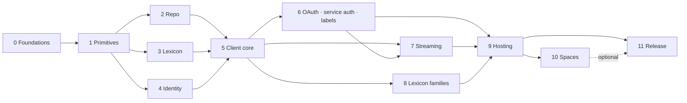

# 05 — Rewrite plan

How the rewrite gets from 0.8 to 0.9: strategy, phases, gates and working agreements.

## Strategy

- **Fresh tree, same repository** ([D-01](06-decisions.md#d-01-rewrite-in-a-fresh-tree-not-by-refactoring-in-place)).
  The new code is built on a long-lived `next` branch. `main` stays on 0.8.x and receives fixes
  only.
- **Behaviour crosses over through specs and the conformance suite**, not by moving files
  ([04 — Testing](04-testing.md#the-behaviour-bridge)). Code may be copied when a spec says
  "keep nearly as-is" (the audits name those parts: `IdentifierSyntax`, the `AtDatetime` parser,
  `TidGenerator`, `IdentityNetworkPolicy`, `ResolutionCache`, `PartialMerkleSearchTree`, the
  commit sig splice, `RepoSyncVerifier`, the replay algorithm, `JetstreamSegmentReader`, OAuth
  validation rules, `ServiceAuthVerifier`'s checks, the Spaces primitives). Copied code is
  restyled to the new guidelines and loses any dependency on 0.8 internals.
- **Bottom-up**, one layer per phase, each one usable and tested before the next starts. Phases
  1–8 and 10 fill namespace areas of the one `ATProtoNet` package; phase 9 builds the extension
  packages.
- **Every phase ends at a gate.** The gate is a checklist, not a date.

Phases 2, 3 and 4 can run in parallel after phase 1. Phases 7 and 8 can run in parallel after
phase 6. Spaces (10) is off the critical path; 0.9 can ship without it.

## Phases

Sizes are rough estimates of hand-written runtime lines (excluding generated code and tests),
for planning only.

### Phase 0 — Foundations

**Goal.** Everything needed to build, test and gate the rewrite exists before any SDK code.

- `next` branch with the new tree layout ([02 — Architecture](02-architecture.md#source-tree))
  and a new `ATProto.NET.slnx`.
- Build infrastructure: `global.json` pinning the SDK, `Directory.Build.props` (shared
  settings, `TreatWarningsAsErrors`, nullable, `IsAotCompatible` for `src/`),
  `Directory.Packages.props` (central package management), `nuget.config` with package source
  mapping, analyzers (PublicApiAnalyzers, CA2007, CS1591 as error), empty API baselines.
- `tests/ATProtoNet.Architecture.Tests` enforcing the namespace layering rules (initially
  against an empty project).
- `tests/ATProtoNet.TestKit` (fake XRPC server, fake identity network, `FakeTimeProvider`, store
  contract base classes, integration gate with traits).
- `tests/ATProtoNet.Conformance` with **all vectors extracted** into data files with a
  `MANIFEST.md` (provenance and licence), the `IProtocolAdapter` interface and
  **`Adapter.Legacy` over the 0.8 packages, green**.
- `tests/ATProtoNet.Benchmarks` with the scenarios from [04 — Testing](04-testing.md#benchmarks),
  **run against 0.8 and the baseline recorded**.
- `/lexicons` vendored from upstream (moved from `tests/…/Upstream`, plus the Spaces proposal
  Lexicons) and `lexicons.json` pinned. Until phase 3's `install` command exists, a script does
  the vendoring.
- CI on both forges through one `build.sh`, with the jobs from
  [04 — Testing](04-testing.md#ci-shape), most of them no-ops until code exists.
- `CLAUDE.md`, `CONTRIBUTING.md` and the issue-workflow skill on `next`, updated for the new
  tree. One source for the CHANGELOG rules; the others link to it.

**Gate.** CI green. The conformance suite is green against 0.8 (or each failure is filed as a
0.8 bug with the vector marked `KnownLegacyFailure`). The benchmark baseline is committed.

### Phase 1 — Primitives (`ATProtoNet`, `ATProtoNet.Data`, `ATProtoNet.Crypto`)

Specs: [syntax](specs/syntax.md), [data-model](specs/data-model.md), [crypto](specs/crypto.md).
Identifier types, multiformats codecs, DRISL reader/writer (strict and lenient), the JSON data
model and its converters, `DataModelValue`, `SignedObject`, CAR reader (bounded, streaming) and
writer, keys and signatures, `did:key`, JOSE. **~5k lines.**

**Gate.** Syntax, data-model, CID/CAR and crypto conformance areas are green on `Adapter.Next`.
Benchmarks for CBOR and CAR are at or better than baseline. No I/O APIs in the foundation layer
(architecture test).

### Phase 2 — Repo (`ATProtoNet.Repo`)

Spec: [repo](specs/repo.md). One MST (grown from `PartialMerkleSearchTree`, with incremental
hashing), commits, record proofs, snapshots, `IBlockStore`. **~2.5k lines.**

**Gate.** MST, commits and proofs conformance areas are green. The MST build/diff benchmark is at
or better than baseline.

### Phase 3 — Lexicon (`ATProtoNet.Lexicon`, the code generator, CLI part 1)

Specs: [lexicon](specs/lexicon.md), [tooling](specs/tooling.md). The schema object model, ref
resolution, validation, the C# emitter, and `atproto-lexgen generate|install|update|lint`. It
starts with **a spike** on bundling the emitter and System.Text.Json into a Roslyn analyzer;
the outcome decides whether the user-facing source generator ships in phase 8 or users get an
MSBuild-task fallback. **~6k lines.**

**Gate.** The emitter generates **all** vendored Lexicons and the output compiles with zero
diagnostics. Golden-output tests for the representative cases are reviewed and committed. The
generated `com.atproto.*` code is checked in under `src/ATProtoNet/Generated/` (it compiles
against stubs until phase 5).

### Phase 4 — Identity (`ATProtoNet.Identity`)

Spec: [identity](specs/identity.md). The untrusted-fetch layer, DNS TXT, DID documents,
resolvers, handle verification, caching, PLC client and typed operations. **~4k lines.**

**Gate.** Identity hardening scenarios ported and green. A pinned PLC genesis vector added and
green. Identity-lookup benchmark at or better than baseline.

### Phase 5 — Client core (`ATProtoNet`, part 1)

Specs: [xrpc-client](specs/xrpc-client.md), [auth](specs/auth.md) (password sessions and the
session model), [stores](specs/stores.md) (session store contract). `AtProtoClient`, the XRPC
pipeline, error model, password sessions, generated `com.atproto.*` wired up, records API,
pagination, `PdsAdminClient`, Lexicon resolution. **~5k lines.**

**Gate.** The XRPC golden wire fixtures pass. Session race scenarios ported and green.
Integration tests against the pinned PDS (`Requirement=Pds|PdsAdmin`) green. The AOT smoke app
logs in, queries and writes a record with zero warnings. XRPC round-trip benchmark at or better
than baseline.

### Phase 6 — OAuth, service auth, labels (`ATProtoNet`, part 2)

Specs: [auth](specs/auth.md), [labels](specs/labels.md). OAuth client and `OAuthSession`, DPoP,
scopes, confidential clients, `ServiceAuthHandler` and `ServiceAuthVerifier`, label signing,
verification and frame codec. **~5k lines.**

**Gate.** Tokens and labels conformance areas green. OAuth flow, callback, refresh and
confidential-client scenarios ported and green against the fake authorization server. A manual
OAuth sign-in against a real PDS is recorded in the PR.

### Phase 7 — Streaming (`ATProtoNet.Streaming`)

Spec: [streaming](specs/streaming.md). The stream runtime, firehose with Sync 1.1 and resync,
label stream, Jetstream (v1 and v2 codecs), archive replay with the cutover combinator, Tap,
PLC export. **~6k lines.**

**Gate.** Firehose, Sync 1.1 (the `Tampered` table) and Jetstream conformance areas green.
Cursor semantics scenarios ported and green. Firehose and Jetstream decode benchmarks at or
better than baseline (the direct CBOR binders should beat it). A nightly live Jetstream run green.

### Phase 8 — Lexicon families and the user source generator

Specs: [lexicon](specs/lexicon.md#generated-clients). The generated `app.bsky`, `chat.bsky`,
`tools.ozone` and `site.standard` code in `ATProtoNet`, the hand-written helpers in
`ATProtoNet.Bluesky` (rich text, posting, profile update, video upload, chat moderation stream),
and the source generator for users' Lexicons, bundled into the `ATProtoNet` package as an
analyzer (or the fallback chosen in phase 3). **~2k lines of helpers.**

**Gate.** 100% of vendored upstream methods have generated clients. Helper scenarios
(`UpdateProfileAsync` swap retry, rich-text facet offsets, video upload) ported and green. The
JSON model benchmark (large feed responses) at or better than baseline. A sample app using a
custom Lexicon through the source generator builds and runs.

### Phase 9 — Hosting (`ATProtoNet.Hosting` namespace, `ATProtoNet.AspNetCore`, `ATProtoNet.EntityFrameworkCore`, `ATProtoNet.Blazor`)

Specs: [hosting](specs/hosting.md), [server](specs/server.md), [stores](specs/stores.md). The DI
builder, client factory, stream workers, health checks, Aspire client integration, the XRPC
server (including subscriptions), service-auth scheme, OAuth web login, labeler endpoints, Tap
webhook, EF stores, the minimal Blazor package. **~6k lines.**

**Gate.** All store implementations pass their contract suites, including concurrency. XRPC
server routing, binding and error scenarios ported and green. OAuth login security scenarios
(CSRF binding, service-auth principal isolation) green. A worker-service sample consumes
Jetstream with no reference to `Microsoft.AspNetCore.App`.

### Phase 10 — Spaces (experimental)

Spec: [spaces](specs/spaces.md). Scope per
[D-24](06-decisions.md#d-24-spaces-scope-in-the-rewrite) and Q-11, against the protocol as it
stands at that point. Every public Spaces type is `[Experimental("ATPROTO001")]`, in the existing
packages. **~4–7k lines depending on Q-11.**

**Gate.** The Spaces conformance area green against the pinned reference implementation. Spaces
integration tests green against a permissioned-data PDS (nightly).

### Phase 11 — Release

- `ATProtoNet.Aspire.Hosting` ported (manifest checks green, pinned image tags).
- `atproto-lexgen diff|publish|resolve`.
- `docs/` rewritten for the new API. The durable concept pages and the protocol sections the
  testing audit identified are carried over; API walkthroughs are rewritten; the 0.7/0.8
  migration guides are dropped. A new **migrating-to-0.9** guide maps every 0.8 entry point to
  its replacement.
- Samples: console (custom Lexicon), worker (firehose and Jetstream), web (OAuth login, per-user
  client, XRPC endpoints with service auth, labeler), Aspire AppHost (managed PDS).
- `0.9.0-preview.1`, a feedback period, then `0.9.0`. `next` replaces `main`.

**Gate.** Everything in [Phase gates](#phase-gates), for all packages. All goals in
[00 — Vision](00-vision.md#goals) met, or the miss is written down and accepted.

## Phase gates

On top of each phase's own criteria, a phase passes only if:

1. **Spec coverage.** Every MUST in the phase's specs has a test carrying its requirement ID, or
   an accepted waiver in the spec's "Open points".
2. **Conformance.** The phase's conformance areas are green on `Adapter.Next`.
3. **Shape rules.** The "less chaotic" checks from
   [00 — Vision](00-vision.md#what-less-chaotic-means-measurably) pass: file size, no
   `InternalsVisibleTo` to non-test assemblies, no mutable statics, architecture tests,
   warnings as errors, AOT-compatible, API baseline committed.
4. **API review.** The phase's public API baseline has been reviewed against
   [03 — API guidelines](03-api-guidelines.md), with findings resolved.
5. **Docs.** Every public member has XML docs. The phase's guide pages exist in draft on `next`
   with compiled samples.
6. **Decisions.** Every open question that blocks the phase ([06 — Decisions](06-decisions.md#open-questions))
   is answered.

## Working agreements

### Issues and PRs

- Each phase has a tracking issue on Forgejo listing its work items. Each work item is an issue
  with a branch and a PR into `next`, following the existing issue workflow.
- PRs stay reviewable: one component or one spec section each, ideally under ~1,500 changed lines
  excluding generated code and vectors.
- A PR that implements requirements lists their IDs in its description.

### Specs are living documents

- A spec change goes in the same PR as the code that needs it, with the reason. Requirement IDs
  are never renumbered.
- A behaviour fix on `main` (0.8.x) that touches protocol behaviour also updates the relevant
  spec on `next`. Vendored-Lexicon updates on `main` merge into `next`.
- When a spec turns out wrong against upstream, upstream wins: fix the spec, then the code.

### Running a phase with a coding agent

Most of this codebase was written by coding agents, and the rewrite will be too. The design is
built for that:

1. Give the agent the phase's section here, its specs, `03-api-guidelines.md` and the relevant
   decisions. Those are the instructions; the 0.8 code is reference material.
2. Port tests first. Requirement IDs and the "Conformance and tests" section of each spec say
   which scenarios to bring over. They should fail against the empty implementation.
3. Implement until they pass. Then run the phase gate checklist.
4. Review against the shape rules before review against behaviour. The 0.8 code shows that
   correct behaviour in the wrong shape is the failure mode to guard against.

### Changelog

`next` keeps its own `CHANGELOG.md` starting at `0.9.0`. During the rewrite it records
user-visible decisions per phase rather than every commit. The release notes for 0.9.0 are the
migration guide.

## Risks

| Risk | Impact | Mitigation |
|---|---|---|
| The rewrite stalls halfway, leaving two codebases | High | Bottom-up phases that each leave a usable, tested layer. Spaces is off the critical path. A preview can ship as soon as phase 8 passes, with hosting following. |
| Behaviour lost in translation | High | Conformance suite green on 0.8 *before* phase 1. Requirement IDs on tests. Regression corpus in [04 — Testing](04-testing.md#regression-corpus). |
| The generator cannot match hand-written quality | Medium | Phase 3's gate requires generating and compiling all vendored Lexicons, plus golden output review, before anything depends on it. |
| Roslyn analyzer packaging problems (System.Text.Json in the compiler) | Medium | Spike first in phase 3, with an MSBuild-task fallback. First-party code is checked in, so the SDK never depends on the analyzer. |
| Upstream protocol changes during the rewrite (OAuth scopes, Lexicon resolution, Sync, Spaces) | Medium | Specs cite upstream sections. Vendored Lexicons update through the CLI. Experimental markers (`ATPROTO00x`) on moving surfaces. |
| Performance regressions | Medium | Benchmarks against the 0.8 baseline at every relevant gate. |
| Users stuck on 0.8 | Low/Medium | 0.8.x gets fixes until 0.9.0 plus a stated support window (proposal: 6 months). The migration guide maps every entry point. |

## Immediate next steps

1. The maintainer reviews this design and answers or accepts defaults for the open questions,
   especially Q-1, Q-3, Q-4, Q-8 and Q-11 ([06 — Decisions](06-decisions.md#open-questions)).
2. Fix the two build-health defects on `main` ([01 — Current state](01-current-state.md#build-health)),
   because `Adapter.Legacy` builds against 0.8.
3. Create the phase tracking issues.
4. Start phase 0.
